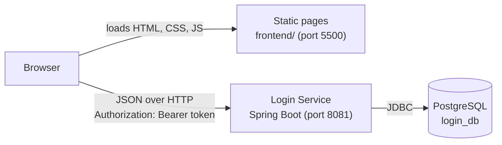
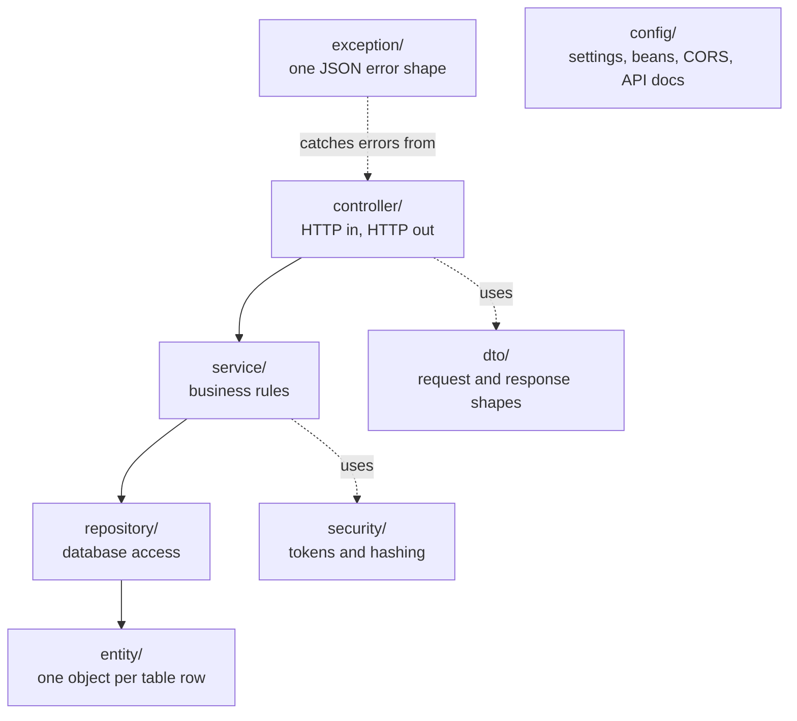
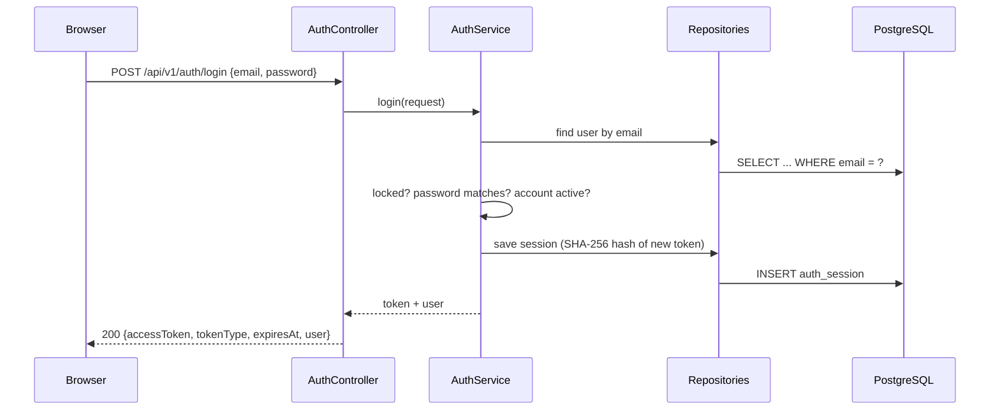
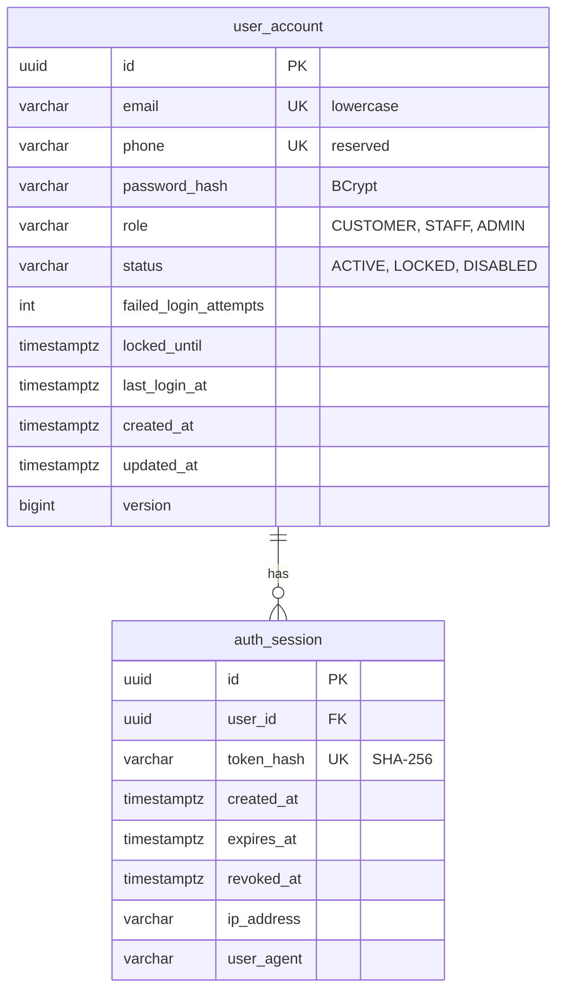

# Login Service: architecture

The Login Service is the first service of the Zodiac boutique platform. It answers two questions:
**who is this person?** and **are they still logged in?**

## What it owns, and what it does not

| Owns | Does not own (future services) |
|---|---|
| Accounts: email, password hash, role, status | Customer profile: name, addresses, preferences (Onboarding Service) |
| Login sessions (tokens) | Products, orders, payments |
| Lockout after repeated failed logins | Store branches and staff schedules |

Other services will refer to a person only by `user_account.id` (a UUID), never by copying credentials.

## Big picture

- The pages and the API are separate programs with separate addresses. The API accepts browser calls only from the origins listed in `zodiac.cors.allowed-origins` (CORS).
- The database belongs to this service alone. Other services must ask the API, never read the tables.

## Inside the service

| Package | Responsibility | Rule |
|---|---|---|
| `controller` | Translate HTTP to Java and back | No business rules |
| `service` | Register, login, lockout, sessions, change password | Entities never leave this layer |
| `repository` | Read and write rows (Spring Data JPA) | Interfaces only |
| `entity` | Mirror the tables | State changes go through methods with meaning, no setters |
| `dto` | The exact JSON fields going in and out | Nothing internal is exposed |
| `security` | Token generation, hashing, header parsing | |
| `exception` | `ApiException`, `ErrorCode`, `GlobalExceptionHandler` | Every error has the same JSON shape |
| `config` | Beans, typed settings, CORS, OpenAPI | |

## Request flow: logging in

Later requests send the token in the `Authorization` header. The service hashes it, looks the hash up, and checks that the session is neither expired nor revoked.

## Data model

All schema changes are Liquibase changelogs in `src/main/resources/db/changelog/`. Hibernate only validates that the entities match the tables.

## Key decisions

| Decision | Why |
|---|---|
| Random opaque tokens stored as SHA-256 hashes | Simple, revocable on logout, and a copy of the database cannot be used to log in |
| BCrypt for passwords | Deliberately slow and salted; only the hash is stored |
| UUID primary keys | Safe to share with other services and not guessable |
| `VARCHAR` plus `CHECK` instead of PostgreSQL `ENUM` | Easier to evolve with a migration |
| One error JSON shape with a stable `code` | Frontends choose the wording, so translations need no backend change |
| `Clock` injected as a bean | Tests can move time forward (expiry, lockout) without waiting |
| Settings from environment variables | The same build runs in every environment |
| PostgreSQL 17.12 | Supported by Amazon Aurora PostgreSQL, so a later move is a connection change |
| API docs generated from code (springdoc) | The documentation cannot drift from the controllers |

## Environments and configuration

| Setting | Local | Other environments |
|---|---|---|
| Database | `application-local.yml` matches `docker-compose.yml` | `DB_URL`, `DB_USERNAME`, `DB_PASSWORD` |
| Allowed web origins | `localhost:5500` | `ZODIAC_CORS_ALLOWED_ORIGINS` |
| API docs page | On | Off by default |
| Profile | `local` (set automatically by `bootRun`) | `SPRING_PROFILES_ACTIVE` |

The service refuses to start if the database settings are missing, instead of guessing. How it is built, packaged and checked on every push is described in [DEPLOYMENT.md](DEPLOYMENT.md).

## Testing strategy

| Layer | Tool | What it proves |
|---|---|---|
| Unit | JUnit 5, Mockito | Each business rule on its own, in milliseconds |
| Integration | Spring Boot test, MockMvc, Testcontainers PostgreSQL | Every endpoint against a real, throwaway database |
| Migrations | Testcontainers | The changelogs build the intended schema from scratch |

## Not in this service yet

Forgot-password and email verification, phone-number login, and a way for other services to validate tokens. They will be added as the neighbouring services appear.
